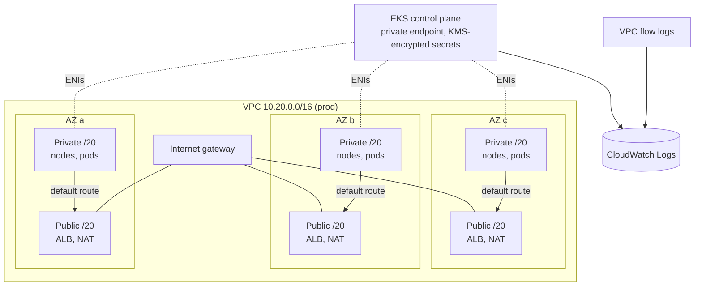
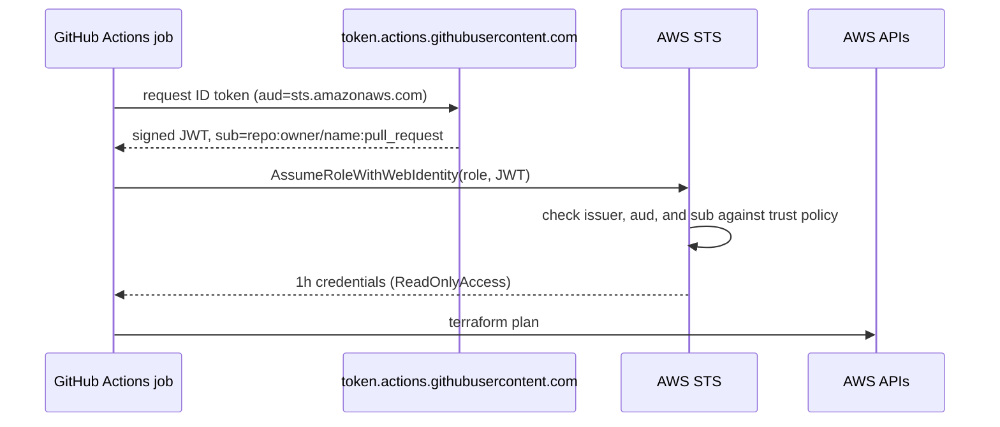

# Architecture

## Network and cluster

- **Subnet plan.** Public subnets use the low `/20`s of the VPC; private subnets start at the
  halfway point. Adding a fourth AZ later doesn't renumber anything.
- **Egress.** `per_az` NAT (prod) keeps each AZ's egress independent, so losing one AZ doesn't cut
  outbound traffic for the others. Dev uses a `single` NAT to save cost.
- **Load balancers.** Subnets carry `kubernetes.io/role/elb` / `internal-elb` and the cluster tag, so the
  AWS Load Balancer Controller discovers them without extra configuration.

## CI identity

No long-lived keys exist anywhere. The trust policy pins the exact repository and ref, so a fork,
another repository, or a feature branch cannot assume the role. In prod, pull requests are not trusted at all.

## State

Each environment has its own state file in S3 with `use_lockfile = true` (native S3 locking,
Terraform 1.10+), so no DynamoDB lock table is required. Environments share modules but never state:
a mistake in dev cannot touch prod.
